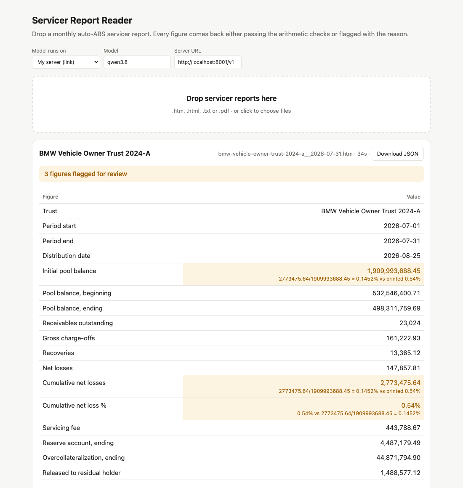

# Deal Report Reader

Give it an auto-loan ABS deal's documents (monthly servicer reports, the deal contracts, loan tapes, a .zip of them,
or just an EDGAR link) and get one deal report back:

- **Deal at a glance**: pool balance and factor, notes outstanding, overcollateralization, reserve, losses, delinquency.
- **Notes**: every class's balance, interest and principal for the month, and the trend over several months.
- **Payment waterfall**: the priority of payments read from the contract, run on the month's figures and checked
  against what the servicer actually paid.
- **Loan pool**: statistics from the loan tape, reconciled to the servicer report's pool balance.
- **Needs review**: anything that didn't pass a check, with the reason.

Every figure is checked with arithmetic the documents have to satisfy, so the report is either verified or tells you
exactly what to look at. Nothing doubtful is passed on silently.

A small project I put together in a few hours by [Vineet](https://aka-vm.github.io). Tested with **Qwen 3.8 27B**
running on my own GPU box. More of my work: **[aka-vm.github.io](https://aka-vm.github.io)**.



## Why a local model

Deal documents and loan data are often confidential. An open model on your own machine or server keeps them on your
hardware, costs nothing per page, and stays reproducible: same model version, temperature 0, a fixed output schema.

A mid-sized open model doesn't read every document perfectly. The checks are what make it usable: its mistakes come
back as flags instead of passing silently, so a person only looks at the flagged items.

## How it works

1. **Sort.** Each document is recognised from its own text: servicer report, contract, prospectus or loan tape. Zips
   are unpacked; an EDGAR trust link downloads the deal's contracts, latest servicer reports and loan tape.
2. **Read servicer reports.** HTML tables are rebuilt as a real grid (merged cells, multi-row and grouped headers) and
   every number is written with its row and full column path, e.g.
   `Net Credit Losses :: Current Period Only = $442,621.32 ; Cumulative > Current Period = $5,840,372.73`.
   The model fills a fixed JSON schema; code (not the model) adds up multi-line figures and restores exact cents.
3. **Check.** Issuer-independent identities: each note class rolls forward, pool minus notes vs overcollateralization,
   gross - recoveries = net loss, cumulative loss % = cumulative losses / initial pool, a period figure can't be most
   of the cumulative one, every figure must actually be printed in the report, and month to month balances carry over.
4. **Read the contract.** The payments section is found automatically, packed with the sections and defined terms it
   relies on, and turned by the model into payment rules in a tiny formula language. Code rejects rules that don't
   parse or use undefined names and asks for a fix, then runs them on the month's opening figures and compares every
   class's interest and principal, the servicing fee and the residual with the servicer report. Amounts are shown only
   when every payment agrees.
5. **Loan tape.** Balance, rates, credit scores, remaining term and delinquency from SEC ABS-EE tapes (XML or CSV);
   the tape's total is reconciled to the report's pool balance.

## Results

Qwen 3.8 27B (4-bit), one pass per document. "Wrong, flagged" means a check caught it; "wrong, not flagged" would be a
silent error.

**Servicer reports**

| reports | issuers | values | correct | wrong, flagged | wrong, not flagged |
|---|---|---|---|---|---|
| 15 development reports | 5 | 780 | 778 (99.7%) | 2 | **0** |
| 16 test reports from issuers never used while building | 4 | 686 | 678 (98.8%) | 8 | **0** |

Answer keys: rule-based parsers for the development reports; for the test reports, the values two reference models
agree on, with every disagreement checked by hand against the report.

**Contracts (payment waterfall checked against the servicer report)**

| deal | result |
|---|---|
| Santander Drive 2024-1 | all 14 payments agree; loan tape matches the pool balance to the cent |
| CarMax 2024-1 | all 18 payments agree (one floating-rate class's interest is taken from the report) |
| Ford Credit 2024-A, AmeriCredit 2024-1 | not reproduced (e.g. note rates missing from the contract excerpt): order shown, amounts flagged for review |

Reading contracts is the harder half and still improving; when it can't confirm the payments it says so.

## Run it

See **[STARTUP.md](STARTUP.md)**: pick where the model runs (Ollama on your machine, your own GPU server by link, a
coding agent you're signed in to, or an API key) and start the page:

```bash
python3 -m reader.selftest                                   # no model needed
python3 app.py --backend ollama --model <model>              # then open http://localhost:8420
```

Drop in documents, a .zip, or an EDGAR link (`CIK 2003263`), press **Build report**, and download it as JSON or PDF.
Try it with `examples/santander-drive-2024-1-deal/` (contracts, a servicer report and a loan tape).

From the command line:

```bash
python3 -m reader.deal examples/santander-drive-2024-1-deal/* --backend ollama --model <model> --out deal.json
python3 -m reader.extract examples/carmax-2024-1__2026-07-31.htm --backend ollama --model <model>   # one report
```

**In Claude or Codex (MCP):** `mcp_server.py` lets an assistant build reports in a chat ("Build a deal report for CIK
2003263"). In Claude Code or Codex, just say *"Set up https://github.com/aka-vm/servicer-report-reader as an MCP
server"* and it follows [AGENTS.md](AGENTS.md). For the Claude web or mobile app, see
[STARTUP.md](STARTUP.md#3-use-it-from-claude-or-codex-mcp).

Using a coding agent? Point it at [AGENTS.md](AGENTS.md); it walks through the setup.

## Files

```
app.py               the page (standard-library HTTP server, background jobs with progress)
mcp_server.py        the same as tools for Claude / Codex (MCP, stdio or HTTP)
STARTUP.md           how to start the server with each kind of model
reader/intake.py     files, zips and EDGAR links -> documents, each classified
reader/convert.py    report file -> model-readable text (table grid rebuild)
reader/extract.py    servicer report -> checked figures (prompt.md, schema.json)
reader/checks.py     the arithmetic checks
reader/contract.py   contract -> payment rules -> run and compare with the servicer report
reader/tape.py       loan tape statistics and reconciliation
reader/deal.py       all of the above -> one deal report
reader/backends.py   Ollama, OpenAI-compatible link, agent CLIs, hosted APIs
examples/            public servicer reports with checked answers, and one full deal (Git LFS)
```

## Limits

Built for US auto-loan ABS (EDGAR filings). PDFs need a text layer (no OCR). The prospectus is not read; the contracts
are. When a report prints two different loss calculations for one month and the model copies the other one
consistently, arithmetic can't tell; the model is asked to mark such fields as ambiguous, and it doesn't always.
